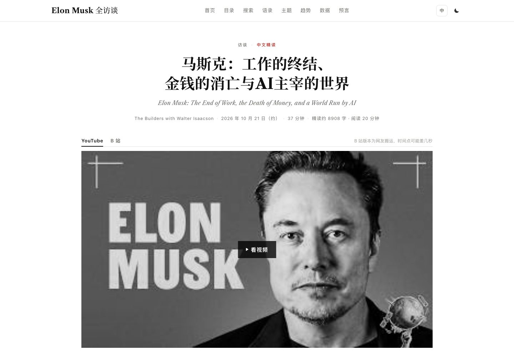

# 马斯克全访谈（elon.qiaomu.ai）

**中文** | [English](#english)


> 把马斯克 1998 年至今的 **651 个公开视频**（访谈、发布会、股东大会），做成**可以读、可以搜、可以追**的中文站：AI 中文精读持续批产、视频在线观看、时间戳跳播、588 份英文文稿逐段全文检索（结果直达视频那一秒）——一个视频一个独立 URL，纯静态，一条命令全量构建。
>
> A Chinese companion to 651 public Elon Musk videos (1998–today): AI deep-reads, embedded video, timestamp jump, full-text search — one URL per video, built by a single Python script.

[**在线阅读 →**](https://elon.qiaomu.ai/) · [话题趋势](https://elon.qiaomu.ai/trends/) · [档案数据](https://elon.qiaomu.ai/stats/) · [预言追踪](https://elon.qiaomu.ai/predictions/) · [语录](https://elon.qiaomu.ai/quotes/) · [免责声明](https://elon.qiaomu.ai/disclaimer/)
[](LICENSE)
[](https://elon.qiaomu.ai/)

**已验证（2026-11-15）**：`python3 tools/build.py` → 651 个视频页 / 586 篇中文精读 / sitemap 660 条 / RSS 最新 20 篇精读；本地构建 + 浏览器实测截图即本仓库产物。

## 这是什么

马斯克每年接受大量访谈、开几十场发布会，但这些内容散落在 YouTube 各处，英文听力门槛 + 找不到出处，让大部分有价值的现场被埋没。参考 [lex.qiaomu.ai](https://lex.qiaomu.ai/)（Lex Fridman 播客中文站）的做法，这个项目做了四件事：

1. **每个视频一页**：大尺寸播放器（滚出视野自动变右下角小窗，边读边看）、X/存档视频直链播放、中英双语标题、英文文稿按语句合并成段落并**时间戳点击跳播**（YouTube IFrame API seek）；有 B 站搬运的视频可在 YouTube / B 站之间切换（国内时区默认 B 站，YouTube 加载失败自动切过去）；英文段落悬停出现「译」，点一下就地显示中文机翻；划线可复制（自动带出处链接）、翻译或生成带二维码的分享海报；
2. **中文精读**：AI 基于完整文稿改写的长文导读（**586 篇**，覆盖全部带文稿访谈：TED2022、JRE #1169/#1609、BBC、Code 2016、AI Day 2022、Tucker Carlson 等），不是机器翻译，是「替你先看一遍」的深度转述；
3. **找得到**：[文稿搜索](https://elon.qiaomu.ai/search/)「马斯克说过什么」在全部英文文稿和中文精读里逐段检索，中文、英文都能搜（谷歌翻译补全词表），按年份分布、从早到晚排序看观点演变，结果直达视频那一秒；首页标题搜索（`/` 或 `⌘K` 唤起）、类型/标签筛选、明暗主题、阅读进度记忆与「继续阅读」；
4. **马斯克特色专题**：22 条带日期的[预言与承诺追踪](https://elon.qiaomu.ai/predictions/)（已兑现/迟到/待验证/未兑现 + 核实结果）、556 条中英双语[语录](https://elon.qiaomu.ai/quotes/)、每期中英双语金句（点时间戳跳播、一键复制带出处链接）、8 大[主题](https://elon.qiaomu.ai/themes/)（AI、火星、出生率、言论自由……）；
5. **数据洞察**：[话题趋势](https://elon.qiaomu.ai/trends/)（26 个话题逐年热力图 + 输入任意中英文词画折线对比、各家公司逐年注意力占比、他最常提到的人、他嘴里的未来年份）、[档案数据](https://elon.qiaomu.ai/stats/)（每年出镜次数、场合分布、最长的对话、「跟马斯克学英语」高频词与原话例句、他在访谈里提到的 27 本书）、预言页的「马斯克时间」承诺兑现时间线。

非官方粉丝项目。本站不托管任何视频文件：YouTube 走官方嵌入，X/其他平台直链原始地址；数据来自 [silicon-valley.tech](https://silicon-valley.tech/)（Elon Musk Archive）公开语料，详见[免责声明](https://elon.qiaomu.ai/disclaimer/)。



## 核心能力

| 能力 | 你得到什么 |
|---|---|
| 中文精读全文 | **586 篇** AI 深度改写导读，覆盖全部带文稿访谈（仅 2 篇转录过短未收录），RSS 全文可订阅，每篇有 Markdown 版（`/ep/{slug}/index.md`） |
| 视频一站看完 | 651 个视频全部可播：YouTube 官方嵌入（点击加载，不拖慢首屏）、X/Internet Archive/原始 MP4 直链 |
| B 站源 | 有 B 站搬运的视频，播放器上方可切换 YouTube / B 站（记住选择；国内时区默认 B 站；YouTube 接口 10 秒加载不出自动切换），时间戳跳播对 B 站同样有效。匹配脚本 `tools/bili_match.py`：`--site` 模式用无头浏览器打开 B 站站内搜索页（英文标题去噪后作关键词）收集候选，再用视频详情接口按简介里的 YouTube 链接或「时长吻合 + 标题相近」核对，结果在 `tools/bili.json` |
| 划线与海报 | 在精读、文稿、金句、语录里划线，弹出「复制 / 生成海报 / 翻译」：复制自动附标题、时间戳和深链；海报为 1080px PNG（中英原话、出处、指向该时刻的二维码），金句和语录卡片也有「生成海报」。实现在 `site/kit.js`，二维码用 `site/vendor/qrcode.js`（MIT） |
| 段落翻译 | 英文文稿每段悬停出现「译」（手机点段落出现），点开在段落下方显示谷歌机翻，可复制译文 + 原文 + 出处 |
| 时间戳跳播 | 文稿与「金句」tab 的时间戳可点击，直接跳到 YouTube 对应位置；`/ep/{slug}/?t=秒` 深链从指定位置播放，`?p=段号` 定位到文稿段落 |
| 英文文稿 | 588 份带文稿：YouTube 字幕 / Whisper 全对话转录 / 第三方整理稿，按语句合并成段落并去掉 um、uh（每页标注来源与可靠性） |
| 文稿搜索 | `/search/` 同时检索英文原话（588 份文稿逐段）与中文精读（逐段，定位回精读原文并高亮）：多词 AND、`a\|b` 任一、`"短语"` 精确匹配；中文词先查内置词表，查不到走免费谷歌翻译（`/api/tr` 经 Nginx 反代并缓存，配置见 `tools/nginx-api-tr.conf`），英文词也会翻成中文去查精读；年份分布筛选，按相关/从早到晚/从晚到早排序 |
| 标题搜索 | 首页多词 AND、加权排序、关键词高亮、URL 同步可分享、标签筛选（Tesla/SpaceX/AI/政治…） |
| 数据洞察 | `/trends/` 话题热力图（每格 = 当年提到该话题的段落占比，点格子搜那一年原话）与自选词折线对比（复用搜索索引和翻译，浏览器端计算）、公司注意力占比（100% 堆叠）、人物提及排行与走势、未来年份分布；`/stats/` 年度堆叠柱、场合与时长条形图、马斯克本人 50 万词里的口头禅排行、他在访谈里提到的书（每本配一句原话，封面与书页链接来自[黑客书架](https://hackerbooks.qiaomu.ai/)，`tools/book_covers.py` 从本地黑客书架项目拷贝封面到 `site/assets/books/`）、他聊过的电影和剧（每部配一句原话，海报由 `tools/movie_posters.py` 通过 OMDb 下载到 `site/assets/movies/`，需 `OMDB_API_KEY`；点海报去豆瓣搜索）；预言页「马斯克时间」：承诺期限 vs 实际兑现的时间线与迟到倍数。计算在 `tools/insights.py`，构建时生成静态 HTML |
| 预言与语录 | 22 条预言追踪（含兑现结果）+ 556 条中英双语语录按年编排 + 每期中英双语金句 + 8 大主题导览 |
| 阅读体验 | 所有页面顶部统一频道导航（首页/目录/搜索/语录/主题/趋势/数据/预言，当前频道高亮，手机上横向滑动）、精读目录侧栏（滚动高亮）、阅读设置（4 款字体 + 15–22px 字号）、明暗主题、阅读进度记忆 |
| SEO / GEO | sitemap、RSS、JSON-LD（VideoObject + Article）、`llms.txt`、每页 canonical 与 OG 卡 |

## 快速开始

### 最快路径：构建 + 本地预览

构建只用 Python 标准库，零第三方依赖：

```bash
git clone https://github.com/joeseesun/elon-musk-cn.git
cd elon-musk-cn

python3 tools/build.py                 # 全量构建到 site/
python3 -m http.server 8124 -d site    # 打开 http://127.0.0.1:8124
```

成功标志：首页出现「651 个公开视频 · 586 篇中文精读」统计与视频卡片，搜索、筛选、详情页、预言追踪（`/predictions/`）、RSS（`/feed.xml`）全部可用。元数据（`tools/elon-master.json`、`tools/translations.json`）与精读全文（`site/zh/`）已入库，clone 下来即是全量数据。

<details>
<summary><strong>完整管线：追新 + 翻译 + 精读批产（macOS）</strong></summary>

精读生成与标题翻译依赖 [Magpie](https://magpie.qiaomu.ai/v1) LLM 网关（或任意 OpenAI 兼容端点，改脚本顶部 `BASE_URL`）与 macOS 钥匙串：

```bash
# 1) 把网关 key 放进钥匙串（工具链统一从这里读，不落盘、不进环境变量）
security add-generic-password -s qiaomu-llm -a magpie -w <你的KEY>

# 2) 从 silicon-valley.tech 同步最新视频与文稿，重建主数据（幂等）
python3 tools/sync_data.py

# 3) 批量翻译中文标题 + 预言/精选/主题文案（断点续跑）
python3 tools/translate_titles.py

# 4) 精读批产：默认跑 STARTER 精选集；--all 跑全部带文稿视频
python3 tools/gen_zh.py
python3 tools/gen_zh.py --all

# 4b) 金句挑选 + 语录中文翻译（写入 data/quotes-zh.json，断点续跑）
python3 tools/translate_quotes.py

# 5) 重新构建站点
python3 tools/build.py
```

各脚本说明：`tools/sync_data.py`（抓取与主数据）、`tools/translate_titles.py`（标题与专题翻译）、`tools/gen_zh.py`（精读生成，含禁用句式校验与重试）、`tools/translate_quotes.py`（双语金句与语录）、`tools/search_index.py`（文稿分段与全文检索索引，构建时调用）、`tools/insights.py`（话题趋势、口头禅、承诺时间线、公司/人物/书/电影/未来年份统计）、`tools/bili_match.py`（B 站搬运匹配，可断点续跑）、`tools/book_covers.py`（书单封面）、`tools/movie_posters.py`（片单海报，OMDb）、`tools/build.py`（全站构建）、`tools/brand.py`（图标与 OG 默认图）。

</details>

## 数据来源与版权边界

- **视频档案、文稿、语录、预言追踪数据**：来自 [silicon-valley.tech](https://silicon-valley.tech/)（Elon Musk Archive）公开语料。该语料明确允许研究与 AI 分析使用，要求注明原始出处；本站每个视频页都保留指向其档案页的链接。
- **视频文件**：版权归 Elon Musk 及各媒体所有。本站不托管、不分发：YouTube 走官方嵌入，X/其他平台直链原始地址。
- **中文精读**：AI 二次创作，非官方翻译，未经审阅；引用请注明「elon.qiaomu.ai 中文精读（AI 改写）」并链接网页版。
- 如权利方认为任何内容不适合展示，请通过下方联系方式反馈，确认后移除。

## 项目结构

```
tools/          构建与管线（sync_data / translate_titles / gen_zh / build / brand）
  elon-master.json    651 条视频主数据（slug、日期、类型、标签）
  translations.json   LLM 翻译的中文标题
  site_config.json    域名与 Umami 统计 ID
data/           源数据（transcripts/ 588 份文稿 JSON、extra.json 预言/语录/主题、quotes-zh.json 双语金句）
site/           构建产物（全站静态文件，不入库的由 build.py 生成）
  zh/                 中文精读 HTML 片段（入库）
docs/screenshots  README 截图
```

## 部署

纯静态站，任何静态托管都可用：把 `site/` 目录发布即可。本站部署在乔木 VPS（Nginx 静态 + Let's Encrypt 证书），域名 `elon.qiaomu.ai`（Cloudflare DNS A 记录指向服务器）：

```bash
python3 tools/build.py && tools/deploy.sh    # 构建 + rsync 到服务器
```

`tools/site_config.json` 里的 `umami` 字段填 [Umami](https://umami.qiaomu.ai/) 统计 website ID 后重新构建即接入统计（登记待完成，见下）。

## 关于向阳乔木

一个人独立维护的非营利项目，没有广告，也不收费。更多项目见 [qiaomu.ai](https://qiaomu.ai/) · [乔木推荐](https://tuijian.qiaomu.ai/) · 博客 [blog.qiaomu.ai](https://blog.qiaomu.ai/)，也可以请作者喝杯咖啡支持一下：

- X：[@vista8](https://x.com/vista8)
- GitHub：[@joeseesun](https://github.com/joeseesun/)
- 公众号：向阳乔木推荐看（站内「关注公众号」扫码）

## License

[MIT](LICENSE)。中文精读内容版权归站点作者所有，转载需注明出处并链接原文页。

---

<a name="english"></a>
# English

**Elon Musk 全访谈 (elon.qiaomu.ai)** is a Chinese companion site to 651 public Elon Musk videos from 1998 to today — interviews, keynotes, product launches and shareholder meetings — modeled after [lex.qiaomu.ai](https://lex.qiaomu.ai/).

## What you get

- **One page per video**: click-to-load YouTube embeds (plus direct playback for X/Internet Archive clips), bilingual titles, and English transcripts with **clickable timestamps** that seek the YouTube player; a YouTube / Bilibili source switch where a re-upload exists; hover-to-translate on transcript paragraphs; select text to copy with citation, translate, or render a share poster with a QR code.
- **AI Chinese deep-reads**: long-form rewrite of each conversation (**586 of 588** transcript-bearing videos covered; 2 skipped for too-short captions), with a Markdown version at `/ep/{slug}/index.md`.
- **Findability**: [transcript search](https://elon.qiaomu.ai/search/) across 588 English transcripts, paragraph by paragraph, with Chinese-to-English keyword mapping, a by-year histogram, oldest-first sorting to trace how a view evolved, and results that jump to the exact second; plus title search (`/` or `⌘K`), kind/tag filters, dark mode, reading progress with "continue reading".
- **Data insights**: a [topic heatmap](https://elon.qiaomu.ai/trends/) (26 topics by year, plus a type-any-word trend chart), [archive stats](https://elon.qiaomu.ai/stats/) (videos per year, venues, longest talks, Musk's most-used English words with example sentences, the books he names on camera, and the films and shows he talks about), company attention share, the people and future years he mentions most, and an "Elon time" promise timeline on the predictions page.
- **Elon-specific archives**: a [dated promises tracker](https://elon.qiaomu.ai/predictions/) (kept / late / open / missed, with verified outcomes), 556 bilingual [quotes](https://elon.qiaomu.ai/quotes/), bilingual per-episode highlights, and 8 recurring [themes](https://elon.qiaomu.ai/themes/).

## Quick start

Build requires only the Python standard library:

```bash
git clone https://github.com/joeseesun/elon-musk-cn.git
cd elon-musk-cn
python3 tools/build.py                 # builds everything into site/
python3 -m http.server 8124 -d site    # open http://127.0.0.1:8124
```

Verified (2026-11-15): `python3 tools/build.py` produces 651 episode pages, 586 Chinese deep-reads, a 660-URL sitemap, RSS with the latest 20 deep-reads, plus search/trends/stats/predictions/quotes/themes pages.

## Data & content boundaries

- Archive data (videos, transcripts, quotes, promises) comes from [silicon-valley.tech](https://silicon-valley.tech/) (Elon Musk Archive), whose corpus permits research and AI analysis with attribution; every video page links back to its archive entry.
- No media files are hosted: YouTube via official embeds, other platforms via original links. All rights remain with their owners.
- Chinese deep-reads are AI-generated second works, not official translations.

See the [disclaimer](https://elon.qiaomu.ai/disclaimer/) for details. Maintained by 向阳乔木 (Joe): [X @vista8](https://x.com/vista8) · [GitHub @joeseesun](https://github.com/joeseesun/). Licensed under [MIT](LICENSE).
