# 马斯克全访谈（elon.qiaomu.ai）

**中文** | [English](#english)

[](LICENSE) [](https://elon.qiaomu.ai/) [](https://github.com/joeseesun/elon-musk-cn/stargazers) [](https://github.com/joeseesun/elon-musk-cn/network/members) [](https://github.com/joeseesun/elon-musk-cn/issues) [](https://github.com/joeseesun/elon-musk-cn/commits/main)

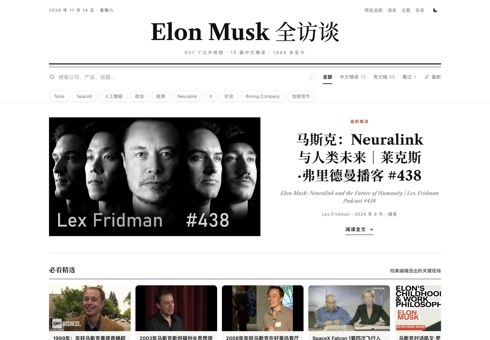

> 把马斯克 1998 年至今的 **651 个公开视频**（访谈、发布会、股东大会），做成**可以读、可以搜、可以追**的中文站：AI 中文精读持续批产、视频在线观看、时间戳跳播、588 份英文文稿逐段全文检索（结果直达视频那一秒）——一个视频一个独立 URL，纯静态，一条命令全量构建。
>
> A Chinese companion to 651 public Elon Musk videos (1998–today): AI deep-reads, embedded video, timestamp jump, full-text search — one URL per video, built by a single Python script.

[**在线阅读 →**](https://elon.qiaomu.ai/) · [文稿搜索](https://elon.qiaomu.ai/search/) · [预言追踪](https://elon.qiaomu.ai/predictions/) · [语录](https://elon.qiaomu.ai/quotes/) · [主题](https://elon.qiaomu.ai/themes/) · [话题趋势](https://elon.qiaomu.ai/trends/) · [档案数据](https://elon.qiaomu.ai/stats/) · [MCP 安装说明](https://elon.qiaomu.ai/mcp/) · [免责声明](https://elon.qiaomu.ai/disclaimer/)

**已验证（2026-11-15）**：`python3 tools/build.py` → 651 个视频页 / 586 篇中文精读 / sitemap 660 条 / RSS 最新 20 篇精读；本地构建 + 浏览器实测截图即本仓库产物。

---

## 图文导览：从看到带走

### 看 · 每一期都是一页


大尺寸播放器滚出视野自动变右下角小窗；中英双语标题、按语句合并的英文文稿、**点时间戳跳到对应秒数**、悬停「译」就地显示中文机翻；划线可复制（自动带出处链接）、翻译或生成带二维码的分享海报。有 B 站搬运的视频可在 YouTube / B 站之间切换，国内时区默认 B 站，YouTube 加载失败自动切过去。

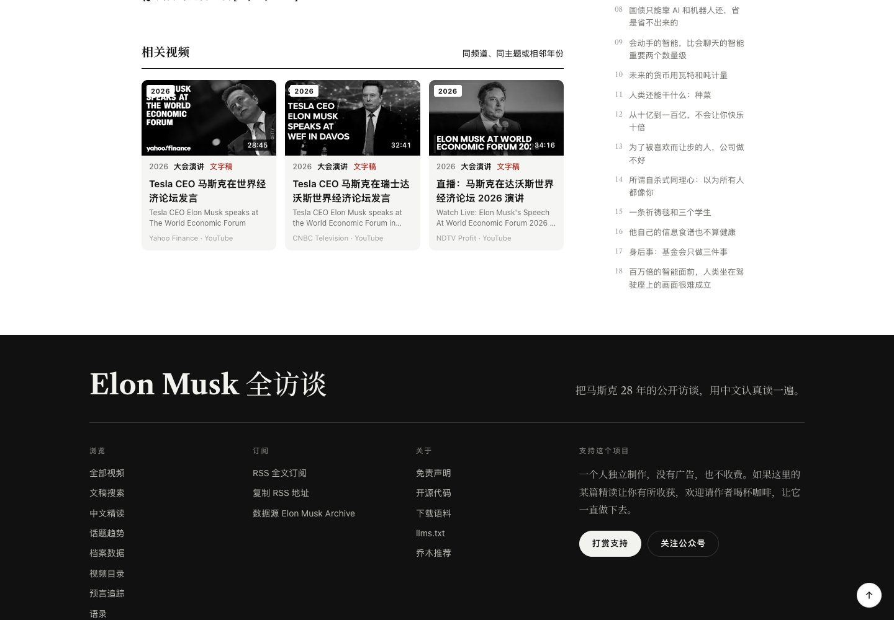

除了「上一个 / 下一个」，每期底部还有 **3 条相关视频**：按同频道、同类型、相近年份与标题词重合度排序，卡片带年份、时长、中英标题和出处，点开直接跳到对应期。

### 搜 · 逐段检索，直达那一秒

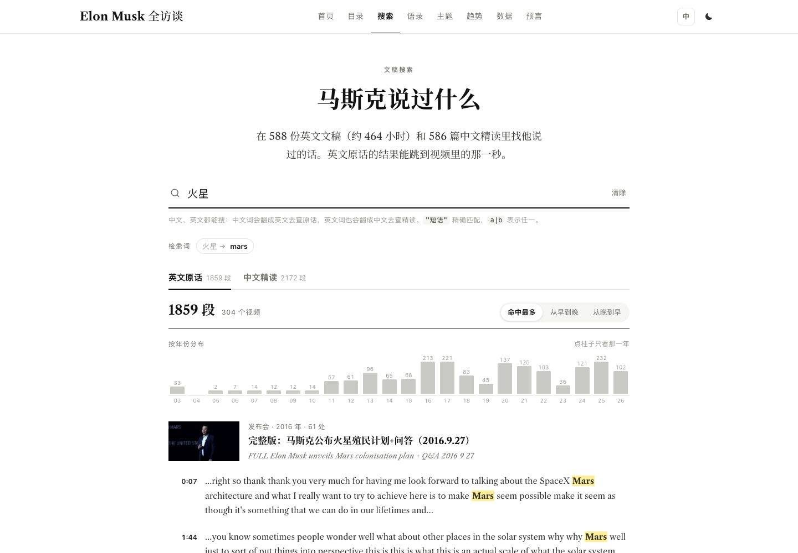

[文稿搜索](https://elon.qiaomu.ai/search/)在 588 份英文文稿和 586 篇中文精读里逐段检索：中文词先查内置词表、查不到走免费翻译补全（`a|b` 任一、`"短语"` 精确匹配），英文词也会翻成中文去查精读；年份直方图、相关/从早到晚/从晚到早排序，结果点击直达视频对应时刻。首页标题搜索用 `/` 或 `⌘K` 唤起；工具栏的 **「随机一篇」** 会从 588 条带文稿或精读的视频里随机挑一期打开，想随手翻到哪期就点它。

### 追 · 马斯克说过的话，后来怎么样了

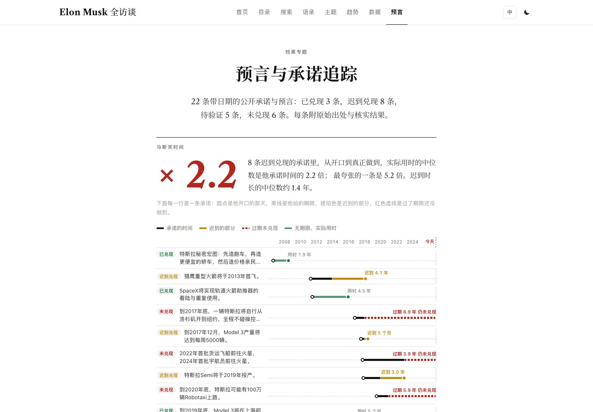

22 条带日期的[预言与承诺追踪](https://elon.qiaomu.ai/predictions/)：已兑现 / 迟到 / 待验证 / 未兑现 + 核实结果。「马斯克时间」把承诺期限与实际兑现画成时间线，迟到倍数一眼可见（目前均值 **2.2×**）。

### 读 · 语录与主题

| 556 条中英双语语录 | 8 大 recurring 主题 |
|---|---|
| 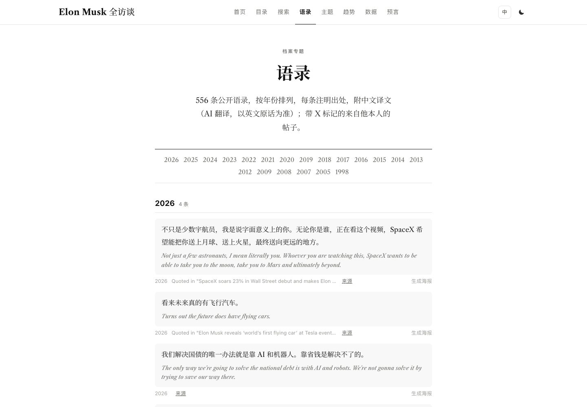 | 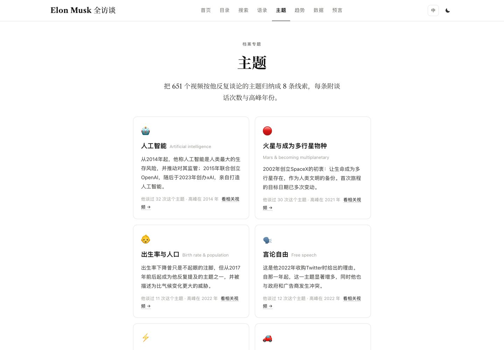 |
| [打开语录 →](https://elon.qiaomu.ai/quotes/) 每期还有中英双语金句，点时间戳跳播、一键复制带出处链接。 | [打开主题 →](https://elon.qiaomu.ai/themes/) AI、火星、出生率、自动驾驶、能源、言论自由、政府、意义。 |

### 算 · 趋势、数据、书单与片单

| 话题趋势：26 个话题热力图 + 自选词折线 | 档案数据：每年出镜、场合、口头禅 |
|---|---|
| 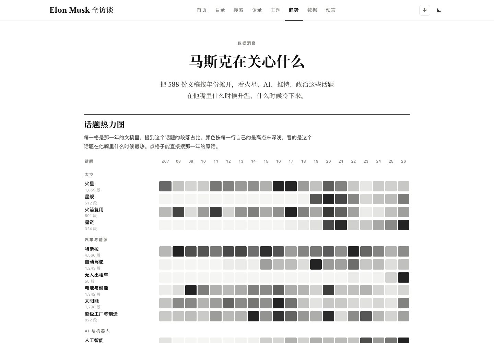 | 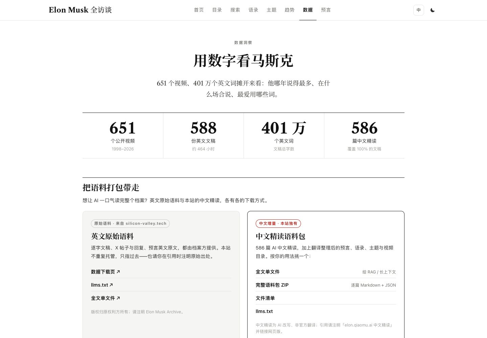 |
| [话题趋势 →](https://elon.qiaomu.ai/trends/) 输入任意中英文词画折线，还有公司注意力占比、人物提及排行、未来年份分布。 | [档案数据 →](https://elon.qiaomu.ai/stats/) 年度堆叠柱、场合与时长、50 万词里的高频口头禅与原话例句。 |

| 他在访谈里提到的 27 本书 | 他聊过的 24 部电影和剧 |
|---|---|
|  |  |
| 每本配一句镜头前原话，点一下跳到那一刻；封面来自[黑客书架](https://hackerbooks.qiaomu.ai/)。 | 每部配一句原话，海报来自 OMDb，点海报去豆瓣搜索。 |

### 带走 · 语料包、MCP 与 Skill

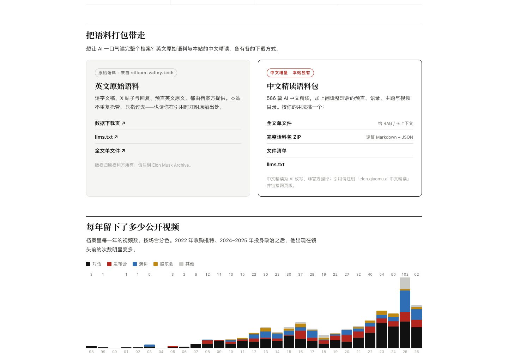

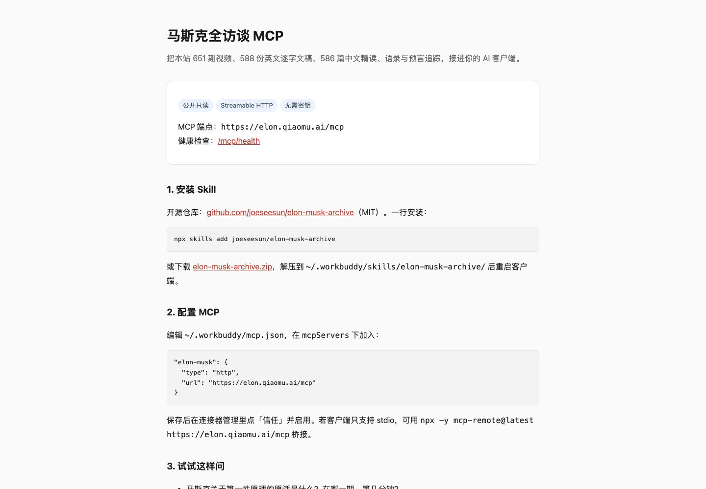

英文原始语料**只链接、不重复托管**；本站把 586 篇中文精读及结构化 JSON 打包给你，也做成公开 MCP 服务和配套 Skill，让 AI 客户端带着出处回答。详见下方[「MCP 与 Skill」](#mcp-与-skill让-ai-带着出处回答)。

### 顺手 · 多语言与手机端

| 8 种界面语言，内容仍是英文原话 + 中文精读 | 手机上频道收进汉堡菜单 |
|---|---|
| 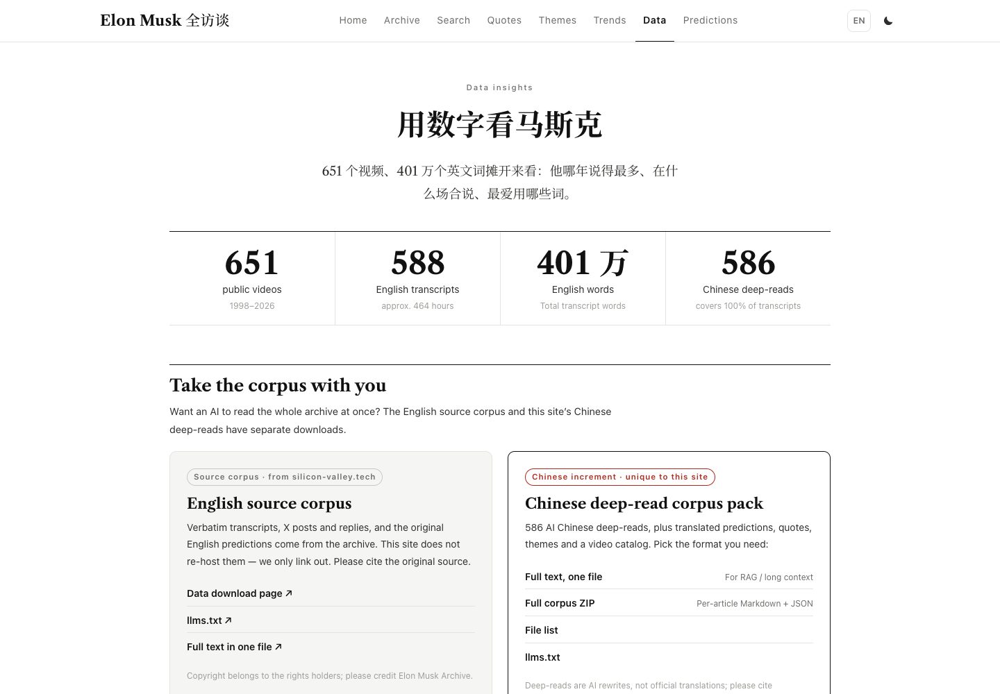 | 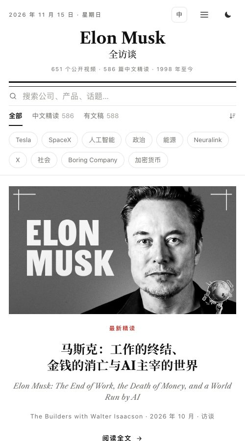 |

---

<details>
<summary><strong>展开：完整能力对照表</strong></summary>

| 能力 | 你得到什么 |
|---|---|
| 中文精读全文 | **586 篇** AI 深度改写导读，覆盖全部带文稿访谈（仅 2 篇转录过短未收录），RSS 全文可订阅，每篇有 Markdown 版（`/ep/{slug}/index.md`） |
| 视频一站看完 | 651 个视频全部可播：YouTube 官方嵌入（点击加载，不拖慢首屏）、X/Internet Archive/原始 MP4 直链 |
| B 站源 | 有 B 站搬运的视频可切换 YouTube / B 站（记住选择；国内时区默认 B 站；YouTube 接口 10 秒加载不出自动切换），时间戳跳播对 B 站同样有效。匹配脚本 `tools/bili_match.py`：`--site` 模式用无头浏览器打开 B 站站内搜索页收集候选，再用详情接口核对，结果在 `tools/bili.json` |
| 划线与海报 | 精读、文稿、金句、语录里划线弹出「复制 / 生成海报 / 翻译」：复制自动附标题、时间戳和深链；海报为 1080px PNG（中英原话、出处、指向该时刻的二维码）。实现在 `site/kit.js`，二维码用 `site/vendor/qrcode.js`（MIT） |
| 段落翻译 | 英文文稿每段悬停出现「译」（手机点段落出现），点开显示谷歌机翻，可复制译文 + 原文 + 出处 |
| 时间戳跳播 | 文稿与「金句」tab 的时间戳可点击跳到 YouTube 对应位置；`?t=秒` 深链从指定位置播放，`?p=段号` 定位到文稿段落 |
| 英文文稿 | 588 份带文稿：YouTube 字幕 / Whisper 全对话转录 / 第三方整理稿，按语句合并成段落并去掉 um、uh（每页标注来源与可靠性） |
| 文稿搜索 | 中英文逐段检索、多词 AND、`a\|b` 任一、`"短语"` 精确；年份分布筛选与三种排序，结果定位回原文并高亮 |
| 标题搜索 | 首页多词 AND、加权排序、关键词高亮、URL 同步可分享、标签筛选（Tesla/SpaceX/AI/政治…） |
| 随机一篇 | 工具栏一键从 588 条带文稿/精读的视频里随机打开一期，自动避开上次抽到的 |
| 相关视频 | 每期底部 3 条推荐：同频道 4 分、同类型 1.2 分、相近年份递减、标题词重合 2.2 分/词，再给精读与精选加权，构建时静态生成 |
| 数据洞察 | 话题热力图与自选词折线（浏览器端计算，复用搜索索引和翻译）、公司注意力 100% 堆叠、人物与未来年份统计、口头禅、书单、片单、承诺兑现时间线。计算在 `tools/insights.py`，构建时生成静态 HTML |
| 阅读体验 | 统一频道导航（首页/目录/搜索/语录/主题/趋势/数据/预言，当前频道高亮，手机横向滑动）、精读目录侧栏（滚动高亮）、4 款字体 + 15–22px 字号、明暗主题、阅读进度记忆与「继续阅读」 |
| 界面多语言 | 8 种界面语言（简中/繁中/英/德/法/西/韩/日），只翻译界面，内容保持英文原话 + 中文精读；自动识别浏览器语言，可手动切换并记住选择，`?lang=de` 可分享 |
| PWA | 可安装到主屏幕、离线保存读过的页面、有新版本提示一键更新 |
| SEO / GEO | sitemap、RSS、JSON-LD（VideoObject + Article）、`llms.txt`、每页 canonical 与 OG 卡 |
| Agent 可读 | 公开 MCP 端点 + 配套 Skill；可下载语料包（全文 / 逐篇 Markdown / 结构化 JSON） |

</details>

非官方粉丝项目。本站不托管任何视频文件：YouTube 走官方嵌入，X/其他平台直链原始地址；数据来自 [silicon-valley.tech](https://silicon-valley.tech/)（Elon Musk Archive）公开语料，详见[免责声明](https://elon.qiaomu.ai/disclaimer/)。

---

## 快速开始

### 前置条件

- [ ] macOS 或 Linux，Python 3.9+（构建**只用标准库**，无需 `pip install`）
- [ ] Git 与网络（clone 仓库；语料、精读、搜索索引已入库）
- [ ] 可选：Chrome + `python3 -m pip install playwright`（仅刷新 README 截图时需要）
- [ ] 可选：Magpie / OpenAI 兼容端点 + macOS 钥匙串（仅追新、重译、重跑精读时需要）

### 构建 + 本地预览（最快路径）

1. 克隆并构建：

   ```bash
   git clone https://github.com/joeseesun/elon-musk-cn.git
   cd elon-musk-cn
   python3 tools/build.py                 # 全量构建到 site/
   ```

   封面图已随仓库存放在 `site/thumbs/`（1301 张 / 57 MB，站点自带不依赖 YouTube 图床，国内打开即加载）。换图库或追新后可用 `python3 tools/fetch_thumbs.py` 增量补齐（纯标准库、并发、断点续跑）。

2. 起本地服务并打开：

   ```bash
   python3 -m http.server 8124 -d site    # 打开 http://127.0.0.1:8124
   ```

3. 验证：首页出现「651 个公开视频 · 586 篇中文精读」统计与视频卡片；`/search/`、`/predictions/`、`/feed.xml` 均返回 200。也可 `curl -I http://127.0.0.1:8124/stats/` 复核。

<details>
<summary><strong>完整管线：追新 + 翻译 + 精读批产（macOS）</strong></summary>

精读生成与标题翻译依赖 [Magpie](https://magpie.qiaomu.ai/v1) LLM 网关（或任意 OpenAI 兼容端点，改脚本顶部 `BASE_URL`）与 macOS 钥匙串：

```bash
# 1) 把网关 key 放进钥匙串（工具链统一从这里读，不落盘、不进环境变量）
security add-generic-password -s qiaomu-llm -a magpie -w <你的KEY>

# 2) 从 silicon-valley.tech 同步最新视频与文稿，重建主数据（幂等）
python3 tools/sync_data.py

# 3) 批量翻译中文标题 + 预言/精选/主题文案（断点续跑）
python3 tools/translate_titles.py

# 4) 精读批产：默认跑 STARTER 精选集；--all 跑全部带文稿视频
python3 tools/gen_zh.py
python3 tools/gen_zh.py --all

# 4b) 金句挑选 + 语录中文翻译（写入 data/quotes-zh.json，断点续跑）
python3 tools/translate_quotes.py

# 5) 重新构建站点
python3 tools/build.py
```

各脚本：`tools/fetch_thumbs.py`（封面图抓取到本地 `site/thumbs/`，小图 mqdefault + 大图 maxresdefault 并自动降级 hqdefault，并发带重试、断点续跑）、`tools/sync_data.py`（抓取与主数据）、`tools/translate_titles.py`（标题与专题翻译）、`tools/gen_zh.py`（精读生成，含禁用句式校验与重试）、`tools/translate_quotes.py`（双语金句与语录）、`tools/search_index.py`（文稿分段与全文检索索引，构建时调用）、`tools/insights.py`（话题趋势、口头禅、承诺时间线、公司/人物/书/电影/未来年份统计）、`tools/bili_match.py`（B 站搬运匹配，可断点续跑）、`tools/book_covers.py`（书单封面）、`tools/movie_posters.py`（片单海报，OMDb，需 `OMDB_API_KEY`）、`tools/build_corpus.py`（可下载语料包，全站构建时调用）、`tools/brand.py`（图标与 OG 默认图）。

</details>

---

## MCP 与 Skill：让 AI 带着出处回答

把全站 651 期视频、588 份英文逐字文稿、586 篇中文精读、语录与预言追踪，接进任意 MCP 客户端。公开只读、无需密钥。

### 一行接入

1. 安装配套 Skill（MIT，[源码](skills/elon-musk-archive/)、[独立仓库](https://github.com/joeseesun/elon-musk-archive)）：

   ```bash
   npx skills add joeseesun/elon-musk-archive
   ```

   验证：`npx skills add joeseesun/elon-musk-archive --list` 应能看到 `elon-musk-archive`。也可下载 `https://elon.qiaomu.ai/mcp/elon-musk-archive.zip`，解压到 `~/.workbuddy/skills/elon-musk-archive/` 后重启客户端。

2. 配置 MCP：编辑 `~/.workbuddy/mcp.json`，在 `mcpServers` 下加入：

   ```json
   {
     "mcpServers": {
       "elon-musk": { "type": "http", "url": "https://elon.qiaomu.ai/mcp" }
     }
   }
   ```

   保存后在连接器管理里点「信任」并启用。只支持 stdio 的客户端可用 `npx -y mcp-remote@latest https://elon.qiaomu.ai/mcp` 桥接。健康检查：`https://elon.qiaomu.ai/mcp/health`。

3. 自然语言示例（AI 会调用工具，返回**段落级命中 + 时间戳 + 深链**，而不是凭印象回答）：

   - “马斯克关于第一性原理的原话是什么？在哪一期、第几分钟？”
   - “他 2023 年以后对 AI 风险的看法有什么变化？”
   - “找出『火星殖民』相关的中文精读，并给出视频链接。”
   - “他说过的预言里，哪些已经兑现、哪些迟到兑现？”

   真实输出样例：

   ```text
   问题：马斯克怎么看“火星”
   命中：Tesla Cybertruck Unveil（2019）· 段落 14 · 11:23
   "...we're going to be using the same alloy in the Starship rocket
   and in the Cybertruck..."
   出处：https://elon.qiaomu.ai/ep/tesla-cybertruck-unveil/?p=14&t=683
   ```

### 9 个只读工具

`search`（全文，中英文/短语/年份）、`get_transcript`（段落 + 时间戳）、`get_deepread`（中文精读 Markdown）、`list_episodes`、`get_episode`、`get_quotes`、`get_predictions`、`get_themes`、`site_info`。参数详见 [`mcp/elon-musk/README.md`](mcp/elon-musk/README.md) 与 [`skills/elon-musk-archive/references/tools.md`](skills/elon-musk-archive/references/tools.md)。

### 本地 / 离线模式

```bash
python3 mcp/elon-musk/elon_mcp_server.py                                   # stdio
ELON_SITE_DIR=/abs/path/elon-website/site python3 mcp/elon-musk/elon_mcp_server.py
python3 mcp/elon-musk/mcp_client.py call search '{"query":"火星","limit":3}'
```

`ELON_SITE_DIR` 指向构建好的 `site/` 后，索引、文稿、精读全读本地文件；`ELON_NO_TRANSLATE=1` 可关闭在线翻译。部署到乔木 VPS：`bash mcp/elon-musk/deploy.sh`（幂等，rsync + systemd + Nginx `/mcp` 反代，端口 8791）。

---

## 可下载语料包（给人与 Agent）

| 文件 | 内容 | 用途 |
|---|---|---|
| `llms-full.txt` | 586 篇中文精读合并为单个纯文本 | 1M 上下文模型 / RAG / Agent 一次读入 |
| `elon-musk-cn-corpus.zip` | 逐篇 Markdown + 结构化 JSON + 说明 | NotebookLM 逐篇作来源、离线下载 |
| `predictions.json` / `quotes.json` / `themes.json` / `videos.json` | 预言、双语语录、主题、视频目录 | 程序化检索与交叉验证 |

入口在[档案数据页](https://elon.qiaomu.ai/stats/#corpus)。在线版：`https://elon.qiaomu.ai/corpus/index.md`（清单）、`.../corpus/README.md`（说明）、`.../llms.txt`（全站索引）。全部由 `python3 tools/build_corpus.py` 从仓库数据生成，clone 下来即可离线重建，不依赖网络。

## 界面多语言（i18n）

站点只构建**一套**静态页面，界面翻译在浏览器运行时完成（`site/i18n.js`），不需要为每种语言生成一套 HTML：

- **支持**：`zh` 简体、`zh-TW` 繁体、`en`、`de`、`fr`、`es`、`ko`、`ja`。
- **只改界面**：导航、标签、按钮、提示、占位符、`aria-label` 等；正文区（精读、英文文稿、语录、搜索摘要、图表数据）一律跳过。
- **语言优先级**：URL `?lang=` > `localStorage` > `navigator.languages` > 默认简体中文。纯静态站读不到访客 IP，按地区展示可在 CDN / 边缘规则里重写 `?lang=xx`。
- **动态文案**：`MutationObserver` 翻译 JS 后插入的界面元素；切换时从缓存原文重译，避免链式翻译，并派发 `i18n:change` 事件。
- **实现位置**：字典与引擎在 `site/i18n.js`，切换器样式在 `site/style.css`（`.i18n-picker`），脚本注入在 `tools/build.py` 的 `I18N_SCRIPT`。改完脚本要递增 `?v=` 绕过浏览器缓存。

## 数据来源与版权边界

- **视频档案、文稿、语录、预言追踪数据**：来自 [silicon-valley.tech](https://silicon-valley.tech/)（Elon Musk Archive）公开语料。该语料允许研究与 AI 分析使用，要求注明原始出处；本站每个视频页都保留指向其档案页的链接。
- **英文原始语料**：逐字文稿、X 帖子与回复、预言英文原文由档案方在 [silicon-valley.tech/#data](https://silicon-valley.tech/#data) 提供下载。本站**不重复托管**，只给链接并注明出处；本站语料包只含中文增量。
- **视频文件**：版权归 Elon Musk 及各媒体所有。本站不托管、不分发：YouTube 走官方嵌入，X/其他平台直链原始地址。
- **中文精读**：AI 二次创作，非官方翻译，未经审阅；引用请注明「elon.qiaomu.ai 中文精读（AI 改写）」并链接网页版。
- 如权利方认为任何内容不适合展示，请通过下方联系方式反馈，确认后移除。

## 项目结构

```
tools/          构建与管线（sync_data / translate_titles / gen_zh / build / brand）
  elon-master.json    651 条视频主数据（slug、日期、类型、标签）
  translations.json   LLM 翻译的中文标题
  site_config.json    域名与 Umami 统计 ID
  capture_screenshots.py  README 截图刷新（Playwright）
data/           源数据（transcripts/ 588 份文稿 JSON、extra.json 预言/语录/主题、quotes-zh.json 双语金句）
site/           构建产物（全站静态文件）
  zh/                 中文精读 HTML 片段（入库）
  mcp/                MCP 安装说明页与 Skill 下载包
mcp/elon-musk    MCP Server（stdio + HTTP）、数据快照、部署脚本
skills/elon-musk-archive  配套 Skill 源码
dist/            打包产物（Skill zip）
docs/screenshots  README 截图
```

## 部署

纯静态站，任何静态托管都可用：把 `site/` 目录发布即可。本站部署在乔木 VPS（Nginx 静态 + Let's Encrypt 证书），域名 `elon.qiaomu.ai`（Cloudflare DNS A 记录指向服务器）：

```bash
python3 tools/build.py && tools/deploy.sh    # 构建 + rsync 到服务器
```

`tools/site_config.json` 里的 `umami` 字段填 [Umami](https://umami.qiaomu.ai/) 统计 website ID 后重新构建即接入统计。

## 自动刷新截图

README 里的 15 张截图由[乔木 skill-publisher](https://github.com/joeseesun/qiaomu-skill-publisher) 的 Web 项目标准生成：先构建或部署站点，再跑脚本；`SCREENSHOT_URL` 可指向本地预览。

```bash
python3 -m pip install playwright
bash tools/deploy.sh                         # 或 python3 -m http.server 8124 -d site
SCREENSHOT_URL=http://127.0.0.1:8124 python3 tools/capture_screenshots.py
```

## 关于向阳乔木

一个人独立维护的非营利项目，没有广告，也不收费。更多项目见 [qiaomu.ai](https://qiaomu.ai/) · [乔木推荐](https://tuijian.qiaomu.ai/) · 博客 [blog.qiaomu.ai](https://blog.qiaomu.ai/)。

- X：[@vista8](https://x.com/vista8)
- GitHub：[@joeseesun](https://github.com/joeseesun/)
- 公众号：向阳乔木推荐看（站内「关注公众号」扫码）

| 打赏支持 | 微信公众号 |
|---|---|
|  |  |

## Troubleshooting

- **`python3 tools/build.py` 报 `EEXIST`**：旧版本对已存在目录的 `mkdir(exist_ok=True)` 误报；当前版本已用 `ensure_dir()` 修复，pull 最新代码后重试。
- **搜索页一直显示「翻译并搜索中…」**：中译英依赖 `/api/tr` Nginx 反代；本地预览没有该接口，改用内置词表里的词（如「火星」「AI」）或英文词即可，部署到线上后自动恢复。
- **`playwright` 截图报缺浏览器**：脚本调用系统 Chrome，用 `CHROME_BIN=/path/to/Chrome python3 tools/capture_screenshots.py` 指定路径。
- **MCP 配置后客户端连不上**：先 `curl https://elon.qiaomu.ai/mcp/health` 看服务是否在；再确认 `~/.workbuddy/mcp.json` 的 `type` 为 `http`，并在连接器管理里点「信任」。
- **`npx skills add` 找不到 Skill**：检查 Skill 仓库的 `SKILL.md` frontmatter 是否用 `description: |` 块标量（含引号/冒号时不能用单行），再重跑安装命令。

## License

[MIT](LICENSE)。中文精读内容版权归站点作者所有，转载需注明出处并链接原文页。

---

<a name="english"></a>
# English


**Elon Musk 全访谈 (elon.qiaomu.ai)** is a Chinese companion site to 651 public Elon Musk videos from 1998 to today — interviews, keynotes, product launches and shareholder meetings — modeled after [lex.qiaomu.ai](https://lex.qiaomu.ai/). One page per video, AI deep-reads in Chinese, timestamped transcripts, and full-text search that lands on the exact second.

## What you get

- **One page per video**: click-to-load YouTube embeds (plus direct playback for X/Internet Archive clips), bilingual titles, and English transcripts with **clickable timestamps**; a YouTube / Bilibili source switch where a re-upload exists; hover-to-translate on transcript paragraphs; select text to copy with citation, translate, or render a share poster with a QR code. Below prev/next, **3 related videos** are statically generated by channel, kind, year and title overlap.
- **AI Chinese deep-reads**: long-form rewrite of each conversation (**586 of 588** transcript-bearing videos covered; 2 skipped for too-short captions), with a Markdown version at `/ep/{slug}/index.md`.
- **Findability**: [transcript search](https://elon.qiaomu.ai/search/) across 588 English transcripts and 586 Chinese deep-reads, paragraph by paragraph, with Chinese-to-English keyword mapping, a by-year histogram, oldest-first sorting, and results that jump to the exact second; plus title search (`/` or `⌘K`), kind/tag filters, dark mode, reading progress with "continue reading".
- **Elon-specific archives**: a [dated promises tracker](https://elon.qiaomu.ai/predictions/) (kept / late / open / missed, with verified outcomes), 556 bilingual [quotes](https://elon.qiaomu.ai/quotes/), bilingual per-episode highlights, and 8 recurring [themes](https://elon.qiaomu.ai/themes/).
- **Data insights**: a [topic heatmap](https://elon.qiaomu.ai/trends/) (26 topics by year, plus a type-any-word trend chart), [archive stats](https://elon.qiaomu.ai/stats/) (videos per year, venues, longest talks, Musk's most-used English words with example sentences, the 27 books and 24 films/shows he names on camera), company attention share, the people and future years he mentions most, and an "Elon time" promise timeline.

| Search: Chinese → English → exact second | Related videos on every episode page |
|---|---|
|  |  |

The homepage toolbar also has a **Random pick** button that opens one of the 588 transcript/deep-read episodes.

| Topic heatmap & trend chart | Corpus + MCP install page |
|---|---|
|  |  |

## MCP & Skill for AI clients

A public, read-only [MCP endpoint](https://elon.qiaomu.ai/mcp/) (Streamable HTTP, no key) exposes 9 tools: `search`, `get_transcript`, `get_deepread`, `list_episodes`, `get_episode`, `get_quotes`, `get_predictions`, `get_themes`, `site_info`. Install the companion [Skill](https://github.com/joeseesun/elon-musk-archive) with `npx skills add joeseesun/elon-musk-archive`, then add to `~/.workbuddy/mcp.json`:

```json
{
  "mcpServers": {
    "elon-musk": { "type": "http", "url": "https://elon.qiaomu.ai/mcp" }
  }
}
```

Ask naturally: *"What exactly did Musk say about first principles — which episode and what minute?"* The answer comes back with paragraph-level hits, timestamps and deep links, not guesswork. Details: [`mcp/elon-musk/README.md`](mcp/elon-musk/README.md).

## Quick start

Build requires only the Python standard library:

```bash
git clone https://github.com/joeseesun/elon-musk-cn.git
cd elon-musk-cn
python3 tools/build.py                 # builds everything into site/
python3 -m http.server 8124 -d site    # open http://127.0.0.1:8124
```

Verified (2026-11-15): `python3 tools/build.py` produces 651 episode pages, 586 Chinese deep-reads, a 660-URL sitemap, RSS with the latest 20 deep-reads, plus search/trends/stats/predictions/quotes/themes pages.

## Data & content boundaries

- Archive data (videos, transcripts, quotes, promises) comes from [silicon-valley.tech](https://silicon-valley.tech/) (Elon Musk Archive), whose corpus permits research and AI analysis with attribution; every video page links back to its archive entry.
- The **English raw corpus** (verbatim transcripts, X posts and replies) is not re-hosted here — download it from [silicon-valley.tech/#data](https://silicon-valley.tech/#data) and cite the source. The [downloadable corpus](https://elon.qiaomu.ai/corpus/index.md) on this site contains only our Chinese increment: 586 AI deep-reads plus structured JSON.
- No media files are hosted: YouTube via official embeds, other platforms via original links. All rights remain with their owners.
- Chinese deep-reads are AI-generated second works, not official translations.

See the [disclaimer](https://elon.qiaomu.ai/disclaimer/) for details. Maintained by 向阳乔木 (Joe): [X @vista8](https://x.com/vista8) · [GitHub @joeseesun](https://github.com/joeseesun/). Licensed under [MIT](LICENSE).
